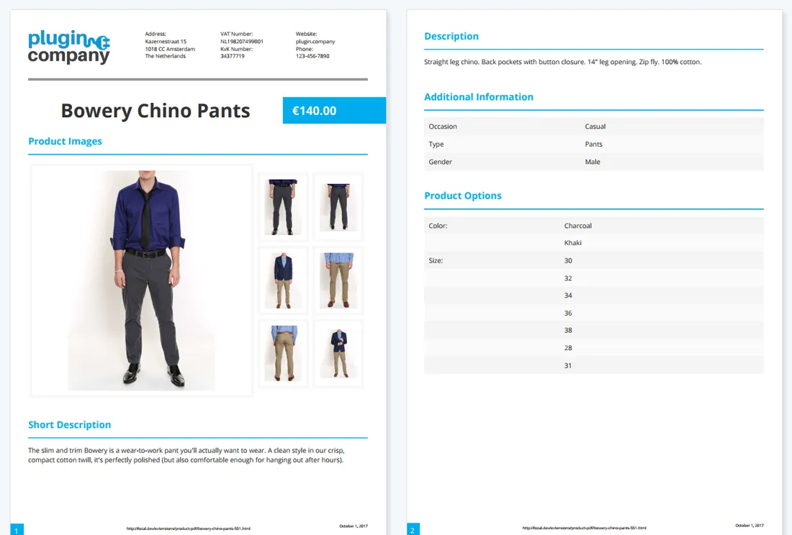
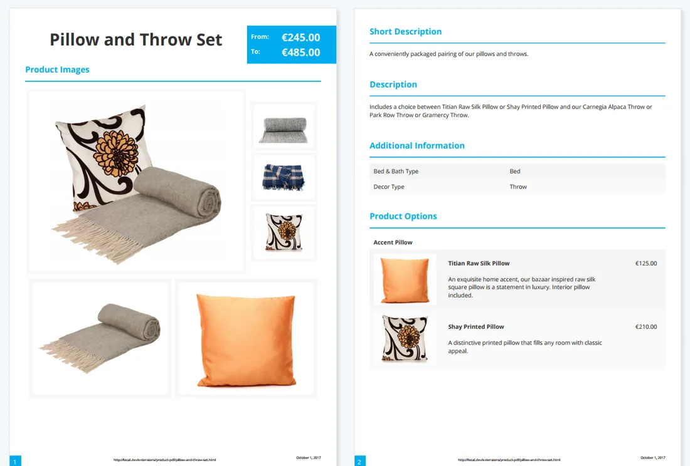
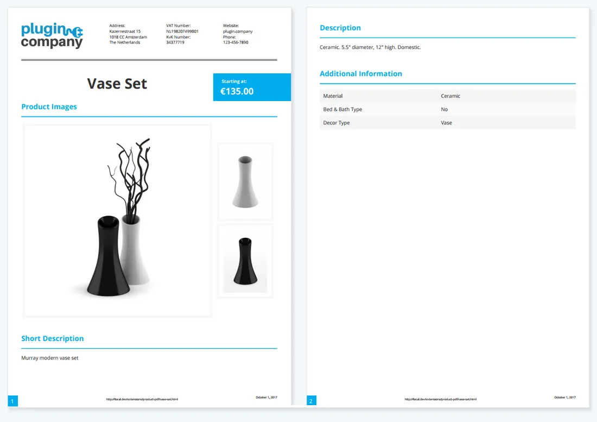
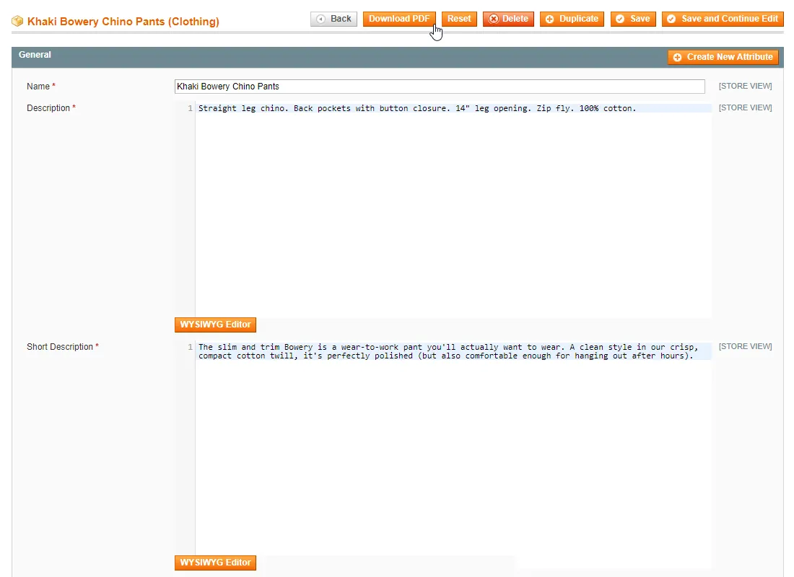

# Product Page PDF for Magento 1 / OpenMage

**Lets customers download a PDF version of your Magento product pages.**


Adds a PDF download to your product pages, so customers can save or print a clean copy of the product information.

The layout, content and design of the PDF are configured in the admin. Works with all product types.

> [!NOTE]
> Product Page PDF is free and open source under the MIT License (since 2026). Plugin Company no longer actively develops this extension, but issues and pull requests are welcome.
>
> The latest code commit on `main` fixes a security issue in earlier versions; release tag `2.6.0` is the original release. See [CHANGELOG.md](CHANGELOG.md).

## Features

- PDF download of product pages for customers
- Supports all product types
- PDF icon or text link in any product page block
- Configurable PDF layout, content and design
- 40 Google fonts and seven image gallery layouts
- Show or hide descriptions, images, prices and custom options
- Drag-and-drop sort order of content sections
- Header with store logo and custom text columns
- Footer with product URL, time stamp and page numbers
- PDF download from the product page in the admin

## Screenshots

<table>
  <tr>
    <td width="50%" valign="top"><br><sub>Configurable product PDF example</sub></td>
    <td width="50%" valign="top"><br><sub>Bundle product PDF example</sub></td>
  </tr>
  <tr>
    <td width="50%" valign="top"><br><sub>Grouped product PDF example</sub></td>
    <td width="50%" valign="top"><br><sub>PDF download icon</sub></td>
  </tr>
  <tr>
    <td width="50%" valign="top"><br><sub>PDF download link</sub></td>
    <td width="50%" valign="top"><br><sub>Download product PDF from admin panel</sub></td>
  </tr>
</table>

More screenshots are on the [product page](https://plugin.company/magento1-extensions/product-page-pdf.html).

## Compatibility

- **Magento:** Community Edition 1.4.x – 1.9.x, Enterprise Edition 1.8.x – 1.14.x
- **Latest version:** 2.6.0 (released 2019-08-01)
- **Composer package:** `plugincompany/magento1-product-page-pdf`
- **Module:** `PluginCompany_ProductLeaflet`

## Installation

### modman

```bash
cd /path/to/magento
modman init   # once per Magento installation
modman clone https://github.com/PluginCompany/magento1-product-page-pdf.git
```

modman creates symlinks, so enable *Allow Symlinks* under System > Configuration > Advanced > Developer > Template Settings.

### Composer

With [magento-hackathon/magento-composer-installer](https://github.com/Cotya/magento-composer-installer) (it reads the `modman` file of this repository):

```bash
composer config repositories.plugin.company composer https://plugin.company/
composer require plugincompany/magento1-product-page-pdf
```

Your project `composer.json` needs the Magento root directory in its `extra` section (and, with Composer 2.2+, the installer plugin allowed), for example:

```json
{
    "extra": { "magento-root-dir": "./" },
    "config": { "allow-plugins": { "magento-hackathon/magento-composer-installer": true } }
}
```

### Manual installation

Download the ZIP of the latest release from the [tags page](https://github.com/PluginCompany/magento1-product-page-pdf/tags) ([2.6.0](https://github.com/PluginCompany/magento1-product-page-pdf/archive/refs/tags/2.6.0.zip)) and copy the `app/`, `js/`, `skin/`, `lib/`, `media/` folders into your Magento root:

```bash
unzip magento1-product-page-pdf-2.6.0.zip
cp -R magento1-product-page-pdf-2.6.0/app magento1-product-page-pdf-2.6.0/js magento1-product-page-pdf-2.6.0/skin magento1-product-page-pdf-2.6.0/lib magento1-product-page-pdf-2.6.0/media /path/to/magento/
```

Step-by-step instructions are in the [installation guide](docs/02-installing-the-magento-extension.md).

### After installing

Clear the cache (System > Cache Management, or `rm -rf var/cache/*`), then log out of the admin and log in again so the new configuration sections and permissions are loaded.

> [!NOTE]
> Some files of this extension are also shipped by other Plugin Company Magento 1 extensions: `js/plugincompany/jquerynoconflict.js` (also in 8 other extensions). The original ZIP packages simply overwrote each other's copy; with modman or the Composer installer the second extension reports an existing target for these paths.

### Upgrading from a purchased copy

Replace the old files with this release. No license key is needed; your settings and data stay as they are.

## Documentation

- [Documentation in this repository](docs/README.md) (Installation Guide, User Manual)
- Online documentation: <https://plugin.company/knowledge-base/docs/magento-product-page-pdf/>
- Product page: <https://plugin.company/magento1-extensions/product-page-pdf.html>
- Magento 2 version: [magento2-product-page-pdf](https://github.com/PluginCompany/magento2-product-page-pdf)

## Changelog

See [CHANGELOG.md](CHANGELOG.md) for the release history.

## Contributing

Found a bug or have an improvement? Please open an [issue](https://github.com/PluginCompany/magento1-product-page-pdf/issues) or send a [pull request](https://github.com/PluginCompany/magento1-product-page-pdf/pulls). Since the extension is no longer actively developed by Plugin Company, fixes from the community are the best way to keep it working on current Magento 1 / OpenMage and PHP versions.

## License

Plugin Company's code in this repository is released under the [MIT License](LICENSE), Copyright (c) 2014-2026 Plugin Company.

Bundled third-party libraries keep their own licenses; see [THIRD-PARTY-NOTICES.md](THIRD-PARTY-NOTICES.md) for the full list.

In particular:

- **mPDF 6.1** (`lib/PC_Mpdf6.1/`) is licensed under **GPL-2.0** (see `lib/PC_Mpdf6.1/LICENSE.txt`), not MIT.
- The extension generates its PDFs with the bundled mPDF library, so a distribution of the extension as a whole has to respect the GPL-2.0.
- The bundled mPDF is version 6.1 from 2016; upstream mPDF has had security fixes since then. The standalone mPDF scripts that the extension does not use were removed (see [CHANGELOG.md](CHANGELOG.md)). For new projects prefer the Magento 2 version ([magento2-product-page-pdf](https://github.com/PluginCompany/magento2-product-page-pdf)), which installs a current mPDF via Composer, or update the bundled library yourself.
